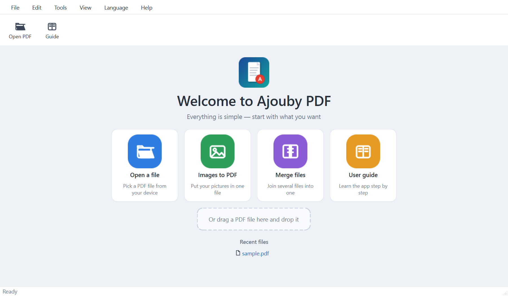
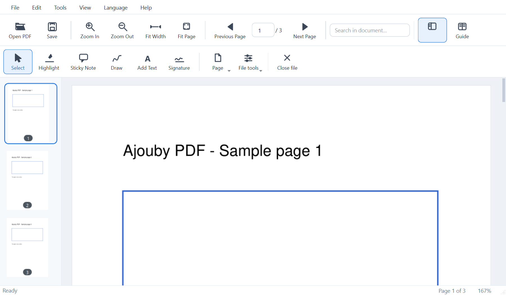

# Ajouby PDF — Windows PDF Reader & Editor

[العربية](README.md) · **English**

A lightweight Windows desktop PDF reader and editor in the spirit of Adobe Acrobat, with a simple, child-friendly interface, full RTL support, and **19 languages**.

`Version 1.2.0` · `Windows 7 / 8 / 10 / 11 (64-bit)` · `19 languages` · `Arabic RTL`

---

## ⬇️ Download

> Installers are attached to the **Releases** page. Pick the build for your Windows version.

| Windows version | Installer | Size | Download |
|---|---|---|---|
| **Windows 10 / 11** — 64-bit | `AjoubyPDF_Setup_win10.exe` | ≈ 102 MB | **[Latest release](../../releases/latest)** |
| **Windows 7 / 8** — 64-bit (Win7 needs SP1) | `AjoubyPDF_Setup_win7.exe` | ≈ 46 MB | **[Latest release](../../releases/latest)** |

- **Not sure which one?** Windows 10/11 → `win10`. Windows 7/8 → `win7`.
- **Windows 7** requires Service Pack 1 and [KB2999226](https://support.microsoft.com/help/2999226) (Universal C Runtime).
- **Windows XP is not supported.**
- The installers are not code-signed yet, so **SmartScreen** may warn you: click **More info** → **Run anyway**.
- Verify your download with [SHA256SUMS.txt](release/SHA256SUMS.txt).

Step-by-step: [Install guide](docs/INSTALL.en.md) · [دليل التثبيت بالعربية](docs/INSTALL.md)

---

## A simpler interface



- **Clear home screen**: four large cards (Open, Images to PDF, Merge, User guide) instead of scattered menus.
- **Smart toolbar**: before a document is open only “Open” and “Guide” appear. Reading tools appear when a document opens, and drawing tools get their own row.
- **Drag and drop**: drop a PDF to open it, several images to make a PDF, or several PDFs to merge them.
- **Recent files** on the home screen and in the File menu, with a clear action.
- **Thumbnails drawn only when needed**, and hidden automatically when the window is narrow.
- **Built-in user guide** (Guide button or `F1`) with a clickable table of contents.
- Large icons and hints, non-blocking success messages, and session restore (language, geometry, sidebar).



---

## What's new in 1.2.0

- **The installer now asks for the language first**:
  1. A setup-language dialog appears first: **English** or **العربية**.
  2. Then an **Application language** page lists all **19 languages**. Your choice is written to `language.txt` in the install folder.
  3. On first launch — or when an upgrade is installed with a different language — the app opens in that language. If you change the language inside the app later, your choice is preserved across normal updates.
- **Windows 7 crash fixed** when opening a PDF (image object lifetime bug).
- **Safe saving**: a failed save no longer closes the document; the original is reopened and password protection is restored.
- **Work-loss protection**: confirmation before opening another file or closing with unsaved changes.
- Better “Fit width” after layout settles, cleaner menu rebuilds on language change, and Arabic/Persian digits in split ranges.

Full history: [CHANGELOG.md](CHANGELOG.md)

---

## Features

- **Read**: zoom, fit width/page, page navigation, thumbnails, in-document search with highlighted hits.
- **Edit**: highlight text, sticky notes, freehand drawing, add text (**correct Arabic shaping and RTL via insert_htmlbox**), insert/delete/rotate pages, fill forms.
- **Sign**: insert a transparent PNG signature at a sensible size while keeping its aspect ratio.
- **File tools**: merge, split (every N pages or ranges), compress, password-protect (AES-256), remove protection.
- **Convert**: pages to PNG/JPG, text export, **Word and Excel export**, images to PDF.
- **OCR**: turn scanned documents into searchable PDFs (requires Tesseract).

---

## Languages

| | | | |
|---|---|---|---|
| 🇸🇦 Arabic (primary — RTL) | 🇬🇧 English | 🇫🇷 French | 🇪🇸 Spanish |
| 🇩🇪 German | 🇮🇹 Italian | 🇵🇹 Portuguese | 🇹🇷 Turkish |
| 🇷🇺 Russian | 🇨🇳 Chinese | 🇯🇵 Japanese | 🇰🇷 Korean |
| 🇮🇳 Hindi | 🇳🇱 Dutch | 🇵🇱 Polish | 🇸🇪 Swedish |
| 🇬🇷 Greek | 🇮🇷 Persian (RTL) | 🇺🇦 Ukrainian | |

The whole UI switches to right-to-left for Arabic and Persian, and the choice is saved automatically.

---

## Install in 3 steps

1. Download the right installer from the [Releases page](../../releases/latest).
2. Run it, then:
   - choose the **setup UI language** (English or العربية) and click OK;
   - choose the **application language** from the list and click Next;
   - finish the wizard.
3. Launch **Ajouby PDF** from the Start menu or the desktop shortcut.

You can change the app language at any time from the **Language** menu, or by reinstalling with another language.

### Silent install

```bat
AjoubyPDF_Setup_win10.exe /SILENT /CURRENTUSER /APPLANG=en
```

- `/APPLANG=` accepts `ar, en, fr, es, de, it, pt, tr, ru, zh, ja, ko, hi, nl, pl, sv, el, fa, uk`.
- Without `/APPLANG=` the installer uses the setup UI language, then Windows, then English.
- `/CURRENTUSER` installs without admin rights; omit it for a per-machine install.

---

## Run from source

```bash
python -m pip install -r requirements.txt
python main.py
```

Requires Python 3.10+ on Windows 10/11 (tested on Python 3.14).

### Windows 7/8 build

```bat
scripts\build_win7.bat
```

The script uses `Python38\python.exe` when present, otherwise `py -3.8`:

```bat
Python38\python.exe -m pip install -r requirements-win7.txt
```

### Build EXEs and installers

```bat
scripts\build_win10.bat
scripts\build_win7.bat
scripts\build_installers.bat
```

- `build_win10.bat` → `dist\AjoubyPDF_win10\AjoubyPDF.exe`
- `build_win7.bat` → `dist\AjoubyPDF_win7\AjoubyPDF_win7.exe`
- `build_installers.bat` → `dist\installers\` (requires [Inno Setup 6](https://jrsoftware.org/isdl.php))

Prepare release assets and SHA-256 checksums:

```bat
python scripts\package_release.py
```

Create a clean source archive for uploading through the GitHub website:

```bat
python scripts\make_source_zip.py
```

Output: `dist\AjoubyPDF-1.2.0-source.zip` — see [release/README.md](release/README.md).

---

## Project layout

```
├── main.py                     # entry point + initial language logic
├── requirements.txt            # Windows 10/11 dependencies (PySide6)
├── requirements-win7.txt       # Windows 7/8 dependencies (pinned PySide2)
├── ajoubi/                     # application package
├── assets/                     # icon and logo
├── docs/                       # guides + screenshots
├── installer/                  # Inno Setup scripts (incl. 19-language page)
├── scripts/                    # build, packaging and helper scripts
├── tests/                      # UI, language and PDF operation tests
└── release/                    # release assets + SHA256SUMS.txt
```

> `build/`, `dist/` and `Python38/` are local build folders and are ignored by Git.

---

## Tests

```bash
python tests/test_ui.py
python tests/test_ui_home.py
python tests/test_lazy.py
python tests/test_word_excel.py
python tests/test_language.py
python tests/test_installer_languages.py
```

---

## Notes

- **Antivirus** software may flag PyInstaller executables — add the install folder to your exclusions if that happens. The app is not code-signed yet.
- **OCR** requires [Tesseract](https://github.com/UB-Mannheim/tesseract/wiki) on `PATH`.
- Password-protected PDFs ask for the password once and are saved with the same protection.
- **Memory**: lazy page and thumbnail rendering, with a 12-megapixel zoom cap. A 500-page document measured around 140 MB total, about 110 MB of which is the Qt engine itself.

---

## Links

- [Install guide (English)](docs/INSTALL.en.md)
- [دليل التثبيت (عربي)](docs/INSTALL.md)
- [User guide (English)](docs/USER_GUIDE.md)
- [دليل الاستخدام (عربي)](docs/دليل_الاستخدام.md)
- [Changelog](CHANGELOG.md)
- [Latest release](../../releases/latest)
- [All releases](../../releases)

---

Made with ❤️ — **Ajouby PDF** 1.2.0
