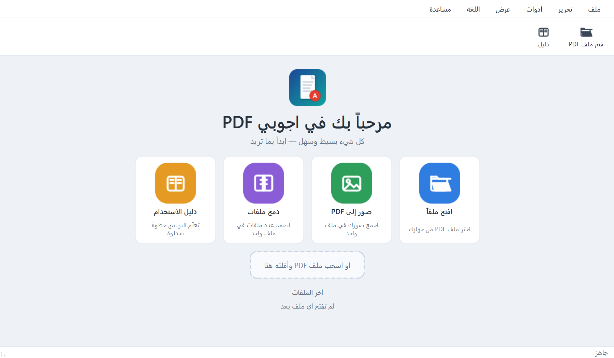
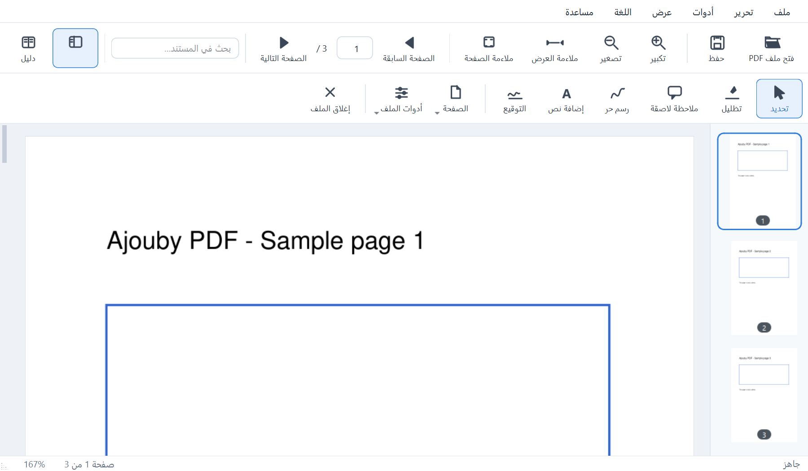
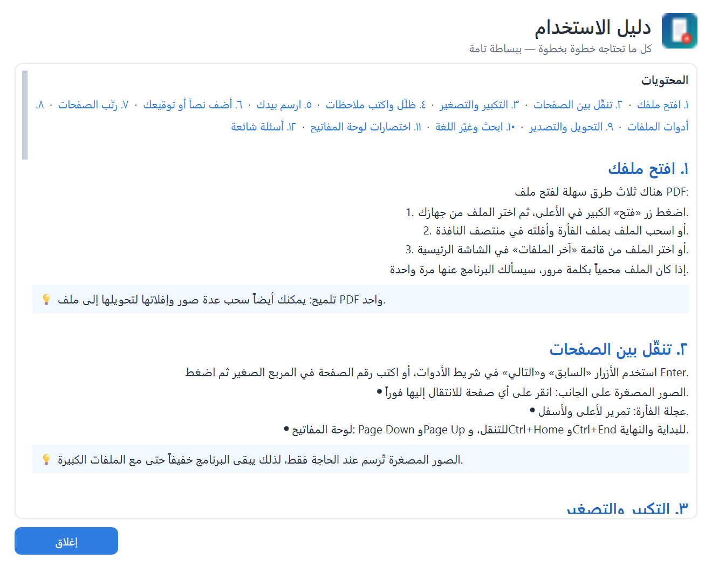

# اجوبي PDF — قارئ ومحرر PDF لويندوز

**العربية** · [English](README.en.md)

برنامج سطح مكتب خفيف لويندوز لقراءة وتحرير ملفات PDF، شبيه بـ Adobe Acrobat، بواجهة بسيطة يفهمها الطفل، ويدعم **19 لغة** مع اتجاه صحيح من اليمين لليسار للعربية والفارسية.

`الإصدار 1.2.0` · `Windows 7 / 8 / 10 / 11 (64-bit)` · `19 لغة` · `واجهة عربية RTL`

---

## ⬇️ تحميل البرنامج

> نزّل نسخة نظامك مباشرة من **أحدث إصدار**. جميع الإصدارات متاحة في صفحة **الإصدارات (Releases)**.

| نظام التشغيل | ملف التثبيت | الحجم | التحميل |
|---|---|---|---|
| **Windows 10 / 11** — 64-bit | `AjoubyPDF_Setup_win10.exe` | ≈ 102 MB | **[تحميل مباشر](../../releases/latest/download/AjoubyPDF_Setup_win10.exe)** |
| **Windows 7 / 8** — 64-bit (ويندوز 7 يحتاج SP1) | `AjoubyPDF_Setup_win7.exe` | ≈ 46 MB | **[تحميل مباشر](../../releases/latest/download/AjoubyPDF_Setup_win7.exe)** |

- **لا تعرف أي نسخة تختار؟** ويندوز 10 أو 11 ← نسخة `win10`. ويندوز 7 أو 8 ← نسخة `win7`.
- **ويندوز 7** يحتاج Service Pack 1 وتحديث [KB2999226](https://support.microsoft.com/help/2999226) (Universal C Runtime).
- **Windows XP غير مدعوم.**
- المثبّتات غير موقّعة رقمياً بعد، لذلك قد يظهر تحذير **SmartScreen**: اضغط **More info** ثم **Run anyway**.
- للتحقق من سلامة الملف: [SHA256SUMS.txt](release/SHA256SUMS.txt).

خطوات التثبيت بالتفصيل: [دليل التثبيت](docs/INSTALL.md) · [Install guide (English)](docs/INSTALL.en.md)

---

## لماذا هذه الواجهة؟



- **شاشة بداية واضحة**: أربع بطاقات كبيرة (افتح ملفاً، صور إلى PDF، دمج ملفات، دليل الاستخدام) بدل قوائم متفرقة.
- **شريط أدوات ذكي**: قبل فتح أي ملف لا يظهر سوى زرّي «فتح» و«دليل». عند فتح مستند تظهر أدوات القراءة، ويظهر شريط أدوات الرسم في صف مستقل.
- **اسحب وأفلت**: أفلت ملف PDF في النافذة لفتحه، أو عدة صور لتحويلها إلى PDF، أو عدة ملفات PDF لدمجها.
- **آخر الملفات**: قائمة سريعة في الشاشة الرئيسية وقائمة «ملف» مع خيار مسحها.
- **صور مصغّرة تُرسم عند الحاجة فقط**، وتُخفى تلقائياً عندما تكون النافذة ضيقة.
- **دليل استخدام داخل البرنامج** (زر «دليل» أو `F1`) مع فهرس قابل للنقر.
- تلميحات وأيقونات كبيرة، ورسائل نجاح غير مقيّدة بنافذة، وإمكانية إكمال العمل من حيث توقفت (اللغة، الحجم، الشريط الجانبي).



---

## ما الجديد في 1.2.0

- **المثبّت يسأل عن اللغة عند البدء**:
  1. أولاً تظهر نافذة لغة واجهة التثبيت: **العربية** أو **English**.
  2. ثم تظهر صفحة **«لغة البرنامج»** وفيها **19 لغة**. اختيارك يُكتب في `language.txt` داخل مجلد التثبيت.
  3. عند أول تشغيل — أو عند ترقية البرنامج بلغة مختلفة — يفتح التطبيق بهذه اللغة. وإذا غيّرت اللغة من داخل البرنامج، يبقى اختيارك محفوظاً في التحديثات العادية.
- **إصلاح انهيار ويندوز 7** عند فتح ملف PDF (مشكلة عمر كائن الصورة).
- **حفظ آمن**: إذا فشل الحفظ لا يُغلق المستند، وتُعاد فتح النسخة الأصلية، مع إعادة توثيق الملفات المحمية بكلمة مرور.
- **حماية من فقدان العمل**: سؤال قبل فتح ملف جديد أو إغلاق البرنامج مع تغييرات غير محفوظة.
- تحسين «ملاءمة العرض» بعد استقرار التخطيط، وتنظيف أزرار القوائم عند تغيير اللغة، ودعم الأرقام العربية/الفارسية في نطاقات التقسيم.

سجل التغييرات الكامل: [CHANGELOG.md](CHANGELOG.md)

---

## الوظائف

- **القراءة**: عرض PDF مع تكبير/تصغير، ملاءمة العرض/الصفحة، تنقل بين الصفحات، صور مصغرة، بحث في المستند مع تظليل النتائج.
- **التحرير**: تظليل نص، ملاحظات لاصقة، رسم حر، إضافة نص (**مع تشكيل صحيح للعربية واتجاه RTL عبر insert_htmlbox**)، إدراج/حذف/تدوير الصفحات، تعبئة النماذج.
- **التوقيع**: إضافة صورة توقيع (PNG شفاف) بحجم منطقي مع الحفاظ على النسبة.
- **أدوات الملفات**: دمج ملفات، تقسيم (كل N صفحة أو نطاقات)، ضغط، حماية بكلمة مرور (AES-256)، إزالة الحماية.
- **التحويل**: تصدير الصفحات كصور (PNG/JPG)، تصدير النص، **تصدير إلى Word وExcel**، تحويل صور إلى PDF.
- **OCR**: تحويل المستند الممسوح إلى PDF قابل للبحث (يتطلب Tesseract).

---

## اللغات المدعومة

| | | | |
|---|---|---|---|
| 🇸🇦 العربية (أساسية — RTL) | 🇬🇧 English | 🇫🇷 Français | 🇪🇸 Español |
| 🇩🇪 Deutsch | 🇮🇹 Italiano | 🇵🇹 Português | 🇹🇷 Türkçe |
| 🇷🇺 Русский | 🇨🇳 中文 | 🇯🇵 日本語 | 🇰🇷 한국어 |
| 🇮🇳 हिन्दी | 🇳🇱 Nederlands | 🇵🇱 Polski | 🇸🇪 Svenska |
| 🇬🇷 Ελληνικά | 🇮🇷 فارسی (RTL) | 🇺🇦 Українська | |

الواجهة تتحول كاملة إلى الاتجاه من اليمين لليسار (RTL) عند اختيار العربية أو الفارسية، والاختيار يُحفظ تلقائياً.

> دليل الاستخدام متوفر بالعربية والإنجليزية داخل البرنامج. أما بقية اللغات فتعرض الدليل بالإنجليزية.

---

## التثبيت في 3 خطوات

1. نزّل ملف التثبيت المناسب من [صفحة الإصدارات](../../releases/latest).
2. شغّله، ثم:
   - اختر **لغة واجهة التثبيت** (العربية أو English) واضغط OK.
   - اختر **لغة البرنامج** من القائمة واضغط «التالي».
   - اتبع الخطوات حتى تنتهي.
3. افتح **اجوبي PDF** من قائمة ابدأ أو من اختصار سطح المكتب.

يمكنك تغيير لغة البرنامج في أي وقت من قائمة **«اللغة»** داخل التطبيق، أو من صفحة الإعدادات عند إعادة التثبيت.

### تثبيت صامت (لمديري الأنظمة)

```bat
AjoubyPDF_Setup_win10.exe /SILENT /CURRENTUSER /APPLANG=ar
```

- `/APPLANG=` تقبل رموز اللغات: `ar, en, fr, es, de, it, pt, tr, ru, zh, ja, ko, hi, nl, pl, sv, el, fa, uk`.
- بدون `/APPLANG=` يستخدم المثبّت لغة واجهة التثبيت، ثم لغة ويندوز، ثم الإنجليزية.
- `/CURRENTUSER` للتثبيت دون صلاحيات مدير، أو احذفه لتثبيت لكل المستخدمين.

---

## دليل الاستخدام

- داخل البرنامج: زر **دليل** في شريط الأدوات أو مفتاح **F1**.
- نسخة نصية كاملة: [دليل الاستخدام](docs/دليل_الاستخدام.md) — ونسخة إنجليزية: [User Guide](docs/USER_GUIDE.md).



---

## التشغيل من المصدر

```bash
python -m pip install -r requirements.txt
python main.py
```

يتطلب Python 3.10+ على ويندوز 10/11 (تم الاختبار على Python 3.14).

### بناء نسخة ويندوز 7/8

```bat
scripts\build_win7.bat
```

يستخدم السكربت `Python38\python.exe` إن وُجد، وإلا `py -3.8`. ثبّت متطلبات تلك النسخة أولاً:

```bat
Python38\python.exe -m pip install -r requirements-win7.txt
```

### بناء ملفات EXE والمثبّتات

```bat
scripts\build_win10.bat
scripts\build_win7.bat
scripts\build_installers.bat
```

- `build_win10.bat` ← `dist\AjoubyPDF_win10\AjoubyPDF.exe`
- `build_win7.bat` ← `dist\AjoubyPDF_win7\AjoubyPDF_win7.exe`
- `build_installers.bat` ← `dist\installers\` (يتطلب [Inno Setup 6](https://jrsoftware.org/isdl.php))

لتجهيز ملفات النشر وحسابات SHA-256:

```bat
python scripts\package_release.py
```

ولإنشاء أرشيف مصدر نظيف للرفع من موقع GitHub (بدون مجلدات البناء):

```bat
python scripts\make_source_zip.py
```

الناتج: `dist\AjoubyPDF-1.2.0-source.zip` — انظر [release/README.md](release/README.md).

---

## هيكل المشروع

```
├── main.py                     # نقطة التشغيل + اختيار اللغة الأولية
├── requirements.txt            # متطلبات ويندوز 10/11 (PySide6)
├── requirements-win7.txt       # متطلبات ويندوز 7/8 (PySide2 مضمّنة الإصدارات)
├── ajoubi/
│   ├── qt_compat.py            # طبقة توافق PySide6 / PySide2
│   ├── theme.py                # الثيم + الأيقونات المرسومة + QSS
│   ├── i18n.py                 # نظام اللغات (19 لغة + RTL)
│   ├── translations_1.py       # الترجمات 1
│   ├── translations_2.py       # الترجمات 2
│   ├── translations_ui.py      # ترجمات الواجهة الجديدة (19 لغة)
│   ├── guide.py                # محتوى دليل الاستخدام (HTML + Markdown)
│   ├── pdf_ops.py              # عمليات PDF (دمج/تقسيم/ضغط/حماية/تحويل/OCR)
│   ├── dialogs.py              # نوافذ التقسيم والنماذج ودليل الاستخدام
│   └── main_window.py          # النافذة الرئيسية (شاشة بداية + عرض كسول + تحرير)
├── assets/                     # الأيقونة والشعار
├── docs/                       # الأدلة + لقطات الشاشة
│   ├── INSTALL.md              # دليل التثبيت (عربي)
│   ├── INSTALL.en.md           # دليل التثبيت (إنجليزي)
│   ├── دليل_الاستخدام.md
│   ├── USER_GUIDE.md
│   └── screenshots/
├── installer/                  # سكربتات Inno Setup
│   ├── installer_win10.iss
│   ├── installer_win7.iss
│   └── language_page.iss       # صفحة اختيار لغة البرنامج (19 لغة)
├── scripts/                    # بناء EXE والمثبّتات وتجهيز الإصدار
├── tests/                      # اختبارات الواجهة واللغات والعمليات
└── release/                    # ملفات النشر + SHA256SUMS.txt
```

> مجلدات `build/` و`dist/` و`Python38/` محلية للبناء ولا تُرفع إلى Git (انظر `.gitignore`).

---

## الاختبارات

```bash
python tests/test_ui.py                 # الواجهة الكاملة + الأدوات + اللغات
python tests/test_ui_home.py            # الشاشة الرئيسية + الصور المصغرة + الدليل
python tests/test_lazy.py               # العرض الكسول والذاكرة
python tests/test_word_excel.py         # عمليات الملفات والتحويل
python tests/test_language.py           # منطق لغة المثبّت واللغة المحفوظة
python tests/test_installer_languages.py # تطابق لغات المثبّت مع لغات البرنامج
```

---

## ملاحظات مهمة

- **مضاد الفيروسات** قد يتعرف على ملفات PyInstaller خطأً — أضف مجلد البرنامج للاستثناءات إذا حصل ذلك. التطبيق غير موقّع رقمياً بعد.
- **OCR** يحتاج تثبيت [Tesseract](https://github.com/UB-Mannheim/tesseract/wiki) وإضافته إلى `PATH`.
- **الخط العربي**: يستخدم البرنامج خطوط ويندوز الافتراضية (Segoe UI أو Tahoma). تأكد من تثبيتها إذا ظهرت مربعات بدل الحروف.
- ملفات PDF المحمية بكلمة مرور تُطلب مرة واحدة عند الفتح، وتُحفظ بنفس الحماية.
- **الذاكرة**: عرض كسول للصفحات والصور المصغّرة، وحد للتكبير 12 مليون بكسل. قياس فعلي لملف من 500 صفحة: نحو 140 MB إجمالاً، منها ~110 MB لمحرك Qt نفسه.

---

## روابط

- [دليل التثبيت (عربي)](docs/INSTALL.md)
- [Install guide (English)](docs/INSTALL.en.md)
- [دليل الاستخدام (عربي)](docs/دليل_الاستخدام.md)
- [User guide (English)](docs/USER_GUIDE.md)
- [سجل التغييرات](CHANGELOG.md)
- [أحدث إصدار](../../releases/latest)
- [كل الإصدارات](../../releases)

---

صُنع بـ ❤️ لمستخدمي PDF العرب — **اجوبي PDF** 1.2.0
