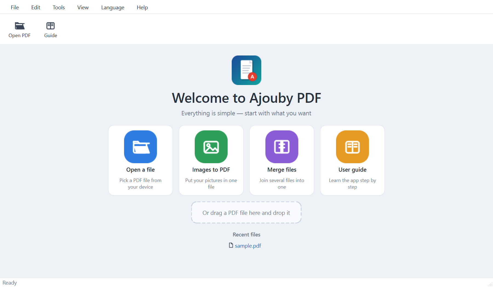
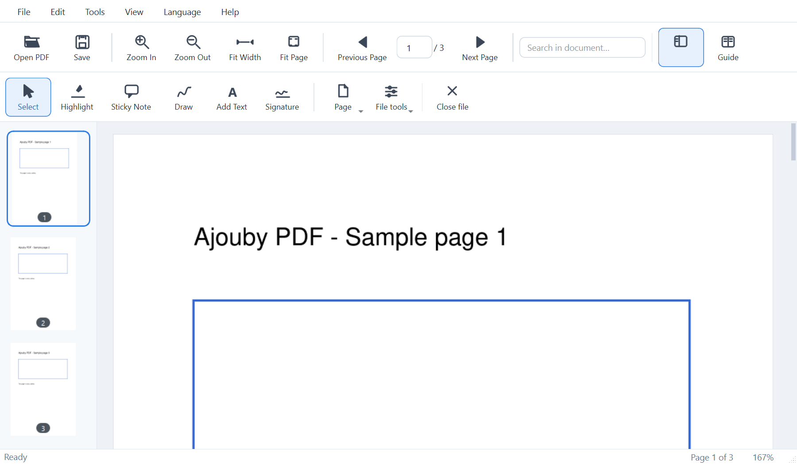
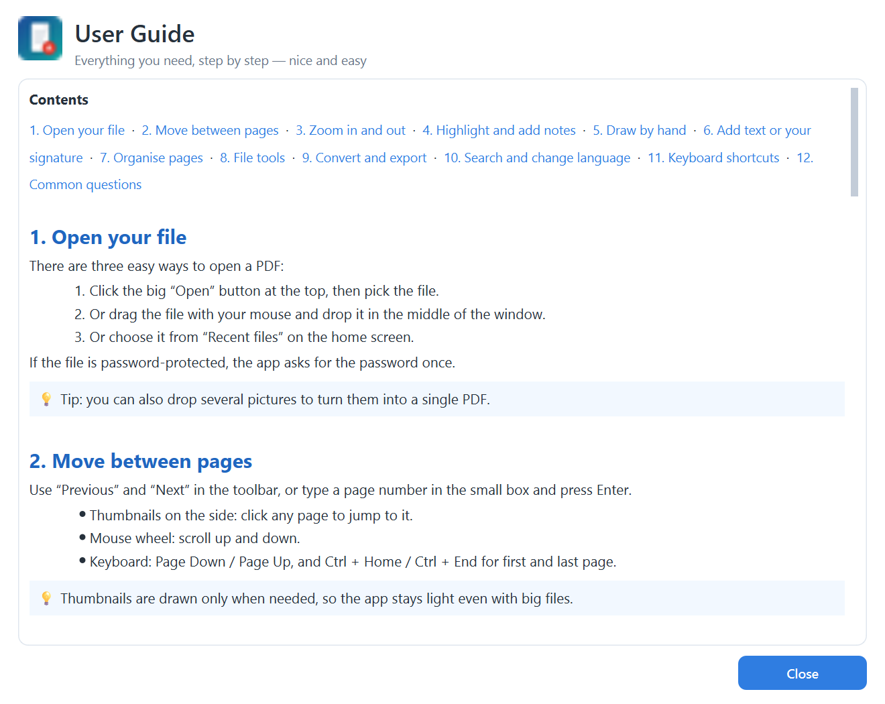

# User Guide

*Everything you need, step by step — nice and easy*

> 💡 You can open this guide inside the app at any time with **F1** or the “Guide” button in the toolbar.

---

## 1. Open your file

There are three easy ways to open a PDF:

1. Click the big “Open” button at the top, then pick the file.
2. Or drag the file with your mouse and drop it in the middle of the window.
3. Or choose it from “Recent files” on the home screen.

If the file is password-protected, the app asks for the password once.

> 💡 Tip: you can also drop several pictures to turn them into a single PDF.

## 2. Move between pages

Use “Previous” and “Next” in the toolbar, or type a page number in the small box and press Enter.

- Thumbnails on the side: click any page to jump to it.
- Mouse wheel: scroll up and down.
- Keyboard: Page Down / Page Up, and Ctrl + Home / Ctrl + End for first and last page.

> 💡 Thumbnails are drawn only when needed, so the app stays light even with big files.

## 3. Zoom in and out

Use the “Zoom in” and “Zoom out” buttons, or Ctrl + mouse wheel.

- “Fit width”: the page width matches the window.
- “Fit page”: the whole page fits on screen.
- The zoom percentage appears at the bottom-left of the window.

## 4. Highlight and add notes

Pick the “Highlight” tool, then drag the mouse over the text you want to highlight.

The “Note” tool adds a sticky note: pick the tool, click a spot, and type your note.

- “Select”: back to normal reading mode.
- Every addition is stored in the file after you press “Save”.

> 💡 If you make a mistake, close without saving — the app will ask you.

## 5. Draw by hand

Pick the “Draw” tool, then press and drag on the page to draw a red line. Release to finish.

Great for a quick signature or for circling something important.

## 6. Add text or your signature

“Text” tool: pick it, click the page, type your text and choose a font size. Arabic and right-to-left text are supported correctly.

“Signature” tool: choose a signature image (transparent PNG), then click the page to place it. The aspect ratio is preserved.

> 💡 Tip: photograph your signature on white paper, then remove the background with any free tool to get a transparent PNG.

## 7. Organise pages

Open the “Page” menu in the toolbar:

- “Rotate right” / “Rotate left”: fix the page orientation.
- “Delete current page”: removes the current page.
- “Insert pages from file”: adds pages after the current page or at the end.

> 💡 Nothing is saved until you press “Save”.

## 8. File tools

From the “File tools” menu or the “Tools” menu:

- “Merge files”: join several PDFs into one.
- “Split file”: cut a file into smaller files (every N pages, or ranges like 1-3,5).
- “Compress”: reduce file size while keeping the content.
- “Protect with password”: encrypt the file with a strong password.
- “Remove protection”: remove the password from a file you know.

> 💡 These tools need the file saved on disk; if you have not saved yet, use “Save As” first.

## 9. Convert and export

From the “File” menu you can:

- Export pages as PNG or JPG images at a chosen resolution.
- Export the text to a text file.
- Export to Word or Excel.
- Turn images into a PDF.
- OCR a scanned file (requires Tesseract).

> 💡 Word and Excel export copies the text only; complex images and layout may not carry over.

## 10. Search and change language

Type a word in the search box and press Enter. The app jumps to the first matching page and highlights matches in yellow.

To change the language, open the “Language” menu and pick one. The whole interface flips to right-to-left for Arabic and Persian, and your choice is remembered.

## 11. Keyboard shortcuts

| Action | Press |
|---|---|
| Open a file | Ctrl + O |
| Save | Ctrl + S |
| Save as | Ctrl + Shift + S |
| Zoom in / out | Ctrl + + / Ctrl + - |
| Fit width / page | Ctrl + 1 / Ctrl + 0 |
| Next / previous page | Page Down / Page Up |
| First / last page | Ctrl + Home / Ctrl + End |
| User guide | F1 |
| Quit | Ctrl + Q |

## 12. Common questions

| Problem | Solution |
|---|---|
| The app asks for a password | The file is protected; enter the correct password or ask the file owner. |
| “Open a PDF first” | Click “Open” and pick a PDF file. |
| “Save the file first” | Use “Save As”, then try again. |
| OCR does not work | Install Tesseract and add it to PATH, then restart the app. |
| Antivirus warning | A common false positive with PyInstaller apps; add the app folder to exclusions. |
| Arabic text is not shown | Make sure Arabic fonts are installed on Windows (Segoe UI or Tahoma). |

> 💡 Last tip: start with a small file, then try the tools one by one. Nothing can be lost — changes are only saved when you press “Save”.

---

*Ajouby PDF — User Guide*

[Back to README](../README.en.md)
