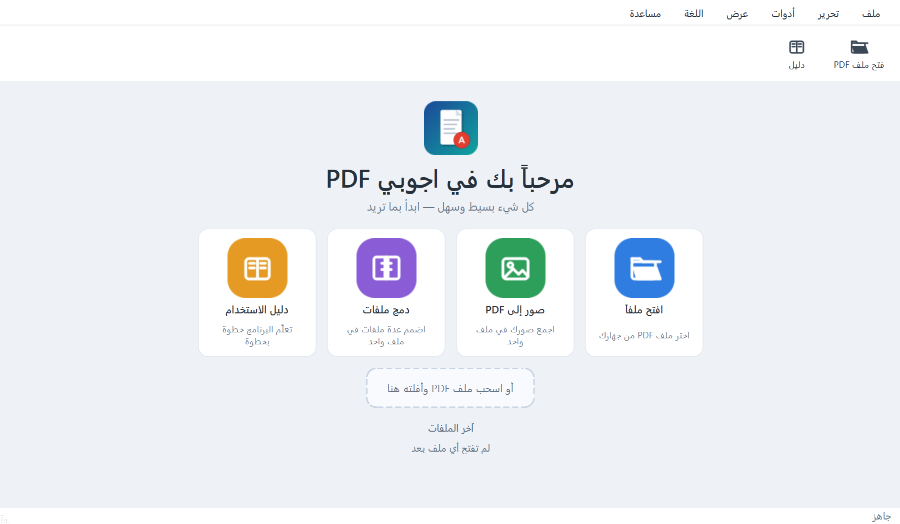
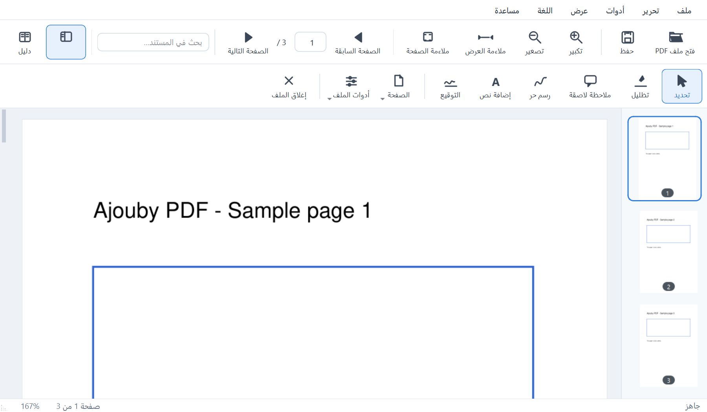
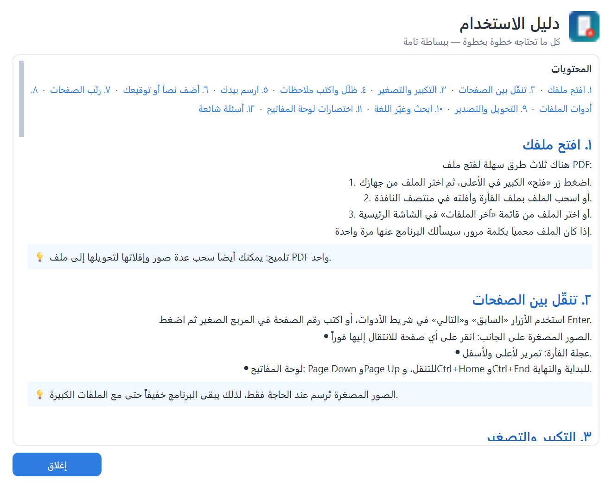

# دليل الاستخدام

*كل ما تحتاجه خطوة بخطوة — ببساطة تامة*

> 💡 يمكنك فتح هذا الدليل من داخل البرنامج في أي وقت بالضغط على **F1** أو زر «دليل» في شريط الأدوات.

---

## ١. افتح ملفك

هناك ثلاث طرق سهلة لفتح ملف PDF:

1. اضغط زر «فتح» الكبير في الأعلى، ثم اختر الملف من جهازك.
2. أو اسحب الملف بملف الفأرة وأفلته في منتصف النافذة.
3. أو اختر الملف من قائمة «آخر الملفات» في الشاشة الرئيسية.

إذا كان الملف محمياً بكلمة مرور، سيسألك البرنامج عنها مرة واحدة.

> 💡 تلميح: يمكنك أيضاً سحب عدة صور وإفلاتها لتحويلها إلى ملف PDF واحد.

## ٢. تنقّل بين الصفحات

استخدم الأزرار «السابق» و«التالي» في شريط الأدوات، أو اكتب رقم الصفحة في المربع الصغير ثم اضغط Enter.

- الصور المصغرة على الجانب: انقر على أي صفحة للانتقال إليها فوراً.
- عجلة الفأرة: تمرير لأعلى ولأسفل.
- لوحة المفاتيح: Page Down وPage Up للتنقل، وCtrl+Home وCtrl+End للبداية والنهاية.

> 💡 الصور المصغرة تُرسم عند الحاجة فقط، لذلك يبقى البرنامج خفيفاً حتى مع الملفات الكبيرة.

## ٣. التكبير والتصغير

استخدم زرّي «تكبير» و«تصغير»، أو اضغط Ctrl مع عجلة الفأرة.

- «ملاءمة العرض»: يجعل عرض الصفحة يناسب النافذة.
- «ملاءمة الصفحة»: يعرض الصفحة كاملة على الشاشة.
- نسبة التكبير تظهر أسفل النافذة على اليسار.

## ٤. ظلّل واكتب ملاحظات

أولاً اختر أداة «تظليل» من شريط الأدوات، ثم اسحب بالفأرة فوق النص الذي تريد تظليله.

أداة «ملاحظة» تُضيف ملاحظة لاصقة: اختر الأداة ثم انقر على المكان المناسب واكتب نص الملاحظة.

- «تحديد»: للعودة إلى الوضع العادي (قراءة فقط).
- كل إضافة تُحفظ داخل الملف بعد الضغط على «حفظ».

> 💡 إذا أخطأت، يمكنك التراجع بالخروج دون حفظ (سيُسألك البرنامج).

## ٥. ارسم بيدك

اختر أداة «رسم حر»، ثم اضغط واسحب على الصفحة لرسم خط أحمر. ارفع إصبعك أو زر الفأرة لإنهاء الرسم.

مفيدة للتوقيع السريع أو وضع دائرة حول معلومة مهمة.

## ٦. أضف نصاً أو توقيعك

أداة «نص»: اخترها، انقر على الصفحة، اكتب النص وحدّد حجم الخط. يدعم البرنامج العربية بشكل صحيح (اتجاه من اليمين إلى اليسار).

أداة «توقيع»: اختر صورة توقيعك (PNG بخلفية شفافة)، ثم انقر على الصفحة لوضعها. يُحافظ البرنامج على نسبة الصورة.

> 💡 تلميح: صوّر توقيعك على ورقة بيضاء، ثم أزل الخلفية بأي أداة مجانية لتحصل على PNG شفاف.

## ٧. رتّب الصفحات

افتح قائمة «الصفحة» في شريط الأدوات:

- «تدوير يميناً» و«تدوير يساراً»: لتصحيح اتجاه الصفحة.
- «حذف الصفحة»: يحذف الصفحة الحالية.
- «إدراج صفحات من ملف»: يضيف صفحات ملف آخر بعد الصفحة الحالية أو في النهاية.

> 💡 لا يُحفظ أي تغيير إلا بعد الضغط على «حفظ».

## ٨. أدوات الملفات

من قائمة «أدوات الملف» أو قائمة «أدوات»:

- «دمج ملفات»: يجمع عدة ملفات PDF في ملف واحد.
- «تقسيم ملف»: يقسّم الملف إلى ملفات صغيرة (كل عدد من الصفحات أو بنطاقات مثل 1-3,5).
- «ضغط الملف»: يقلّل حجم الملف مع الحفاظ على المحتوى.
- «حماية بكلمة مرور»: يشفّر الملف بكلمة مرور قوية.
- «إزالة الحماية»: يزيل كلمة المرور من ملف تعرفه.

> 💡 هذه الأدوات تحتاج ملفاً محفوظاً على القرص؛ إذا لم تحفظ بعد فاستخدم «حفظ باسم» أولاً.

## ٩. التحويل والتصدير

من قائمة «ملف» يمكنك:

- تصدير الصفحات كصور PNG أو JPG بدقة تختارها.
- تصدير النص إلى ملف نصي.
- تصدير إلى Word أو Excel.
- تحويل صور إلى PDF.
- التعرّف الضوئي OCR لملف ممسوح (يتطلب تثبيت Tesseract).

> 💡 التحويل إلى Word وExcel يصدّر النص فقط؛ الصور والتنسيق المعقّد قد لا تنتقل كما هي.

## ١٠. ابحث وغيّر اللغة

اكتب كلمة في مربع البحث واضغط Enter. سينتقل البرنامج إلى أول صفحة تحتوي النتائج ويظلّلها بالأصفر.

لتغيير اللغة: قائمة «اللغة» ثم اختر لغتك. تتحول الواجهة كاملة إلى اليمين لليسار عند العربية والفارسية، ويُحفظ اختيارك تلقائياً.

## ١١. اختصارات لوحة المفاتيح

| للقيام بـ | اضغط |
|---|---|
| فتح ملف | Ctrl + O |
| حفظ | Ctrl + S |
| حفظ باسم | Ctrl + Shift + S |
| تكبير / تصغير | Ctrl + + / Ctrl + - |
| ملاءمة العرض / الصفحة | Ctrl + 1 / Ctrl + 0 |
| الصفحة التالية / السابقة | Page Down / Page Up |
| أول / آخر صفحة | Ctrl + Home / Ctrl + End |
| دليل الاستخدام | F1 |
| إغلاق البرنامج | Ctrl + Q |

## ١٢. أسئلة شائعة

| المشكلة | الحل |
|---|---|
| البرنامج يطلب كلمة مرور | الملف محمي؛ أدخل كلمة المرور الصحيحة أو اطلبها من مالك الملف. |
| «افتح ملفاً أولاً» | اضغط «فتح» واختر ملف PDF. |
| «احفظ الملف أولاً» | استخدم «حفظ باسم» ثم أعد المحاولة. |
| OCR لا يعمل | ثبّت Tesseract وأضفه إلى PATH، ثم أعد تشغيل البرنامج. |
| مضاد الفيروسات ينبّه | هذا خطأ شائع في ملفات PyInstaller؛ أضف مجلد البرنامج للاستثناءات. |
| الخط العربي لا يظهر | تأكد من تثبيت الخطوط العربية في ويندوز (Segoe UI أو Tahoma). |

> 💡 نصيحة أخيرة: ابدأ بملف صغير للتجربة، ثم جرّب الأدوات واحدة واحدة. لا يوجد ما يمكن أن تخسره — التغييرات لا تُحفظ إلا عندما تضغط «حفظ».

---

*اجوبي PDF — دليل الاستخدام*

[العودة إلى README](../README.md)
